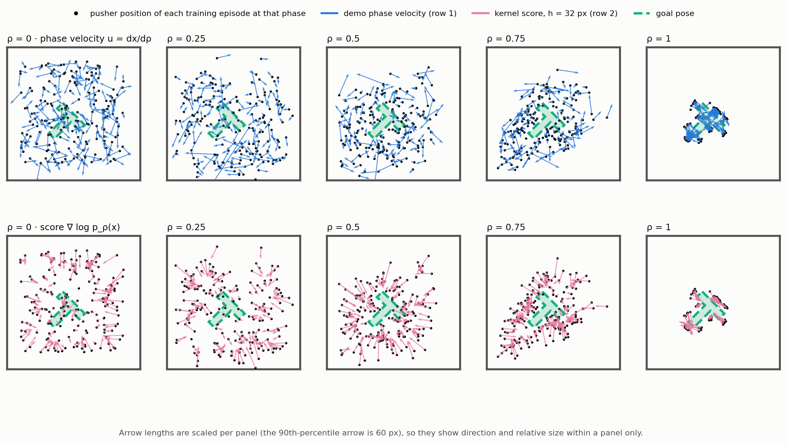

# Push-T policy evaluation

Generated by `scripts/pusht/summarize_pusht_policy.py` from `runs/pusht/policy/`. Mean ± std over seeds. Design notes and history are in `fm_bc/pusht/STATUS.md`.

**Seeds.** The tables in this file are from the first training of every arm, mostly 5 seeds (the *seeds* column gives each row's count); those runs now sit in `runs_pusht_4090/pusht/policy/`. The paper's Push-T figures use a 10-seed retraining of the same arms, now in `runs/pusht/policy/`. That retraining was rolled out only under the evaluation clock, so regenerating this file from it would drop the nominal-clock and `last.pt` sections.

## Setup

* **Data** -- Diffusion Policy's Push-T demonstrations (206 human episodes). **Split** over all episodes (seed 42): 185 train / 21 validation, no test episodes: the closed-loop rollouts are the test, and the offline *test* columns below read the validation episodes.
* **Model** -- inputs `[o, x, ρ]`: the T-block pose `o` (min-max xy, cos θ, sin θ), the agent position `x` and `2ρ − 1`, with the oracle phase `ρ = t/(L−1)`. Output: the agent's phase velocity `u = dx/dρ = (L−1)(x_{k+1} − x_k)` in normalized position units. 4×512 silu MLP.
* **Methods** -- **MLP** (no ρ input), **MLP+phase**, and **MLP+phase+score**: the phase-velocity MSE plus `λ E|(u − û)·∇log p_ρ(x)|`, the kernel score of the training episodes' agent positions at the same phase, λ held constant (`_const`) or annealed to 0 by cosine over the first part of training (`_cos<fraction>`). **MLP+score** is the no-phase ablation: the MLP's network with MLP+phase+score's regularizer and hyperparameters (the score is still indexed by the demonstrations' phase, in training only).
* **Training** -- Diffusion Policy's `pusht_lowdim` pipeline: 500 epochs, batch 256, AdamW 0.0001, cosine with 500 warmup steps, EMA. The checkpoint evaluated is the EMA model at the lowest validation loss.

## Metrics

The metrics in this section and the next are **offline**: the policy is evaluated on the demonstrations' own states. The closed-loop rollouts in gym-pusht, the headline metrics, follow in their own sections.

* **u-RMSE** -- RMSE of the predicted phase velocity against the demonstration's, in normalized units per unit phase (lower is better). **u = 0** (standing still) is given for scale.
* **next-pos px** -- the same error as the pixel error of the next agent position after one Euler step `x + û Δρ`.
* **t1 / t2 / t3** -- u-RMSE in the first, middle and last third of phase.
* **p** -- Welch t-test against MLP+phase+score over seeds, the full arm.

## Test set

MLP+phase+score is `score_w2.5_const`: the λ, anneal fraction and bandwidth with the lowest validation loss in the sweep below (`score_w2.5_cos0.5`), trained with λ held constant instead of annealed -- the default schedule, compared with the annealed one in the ablation further down. u = 0 scores **6.918** on test.

| method | seeds | test u-RMSE | next-pos px | t1 | t2 | t3 | val u-RMSE | best epoch | p vs MLP+phase+score |
|---|---:|---:|---:|---:|---:|---:|---:|---:|---:|
| MLP | 5 | 5.286 ± 0.047 | 9.12 | 6.39 | 4.94 | 4.33 | 5.286 ± 0.047 | 111 | 0.038 |
| MLP+score (`mlp_score_w2.5_const`) | 5 | 5.282 ± 0.035 | 9.14 | 6.42 | 4.87 | 4.33 | 5.282 ± 0.035 | 152 | 0.016 |
| MLP+phase | 5 | 5.203 ± 0.019 | 8.55 | 5.97 | 5.26 | 4.24 | 5.203 ± 0.019 | 150 | 0.095 |
| MLP+phase+score (`score_w2.5_const`) | 5 | 5.224 ± 0.016 | 8.58 | 5.97 | 5.22 | 4.37 | 5.224 ± 0.016 | 221 | — |

## Closed-loop rollouts (gym-pusht)

Diffusion Policy's test protocol: 50 envs (seeds 100000–100049), at most 300 steps; **score** is the episode's max reward `clip(coverage / 0.95, 0, 1)`, **success** is coverage > 0.95. The `best.pt` of every seed is rolled out. **Phase**: nominal clock `ρ_t = min(t / (L_med − 1), 1)` with the median training-episode length L_med = 123, so ρ saturates at step 122; the displacement `u Δρ` is executed exactly through the inverse of the env's PD controller (`fm_bc/pusht/sim.py`). A policy that never moves scores **0.139**.

| method | seeds | score | success | final coverage | p (score) vs MLP+phase+score |
|---|---:|---:|---:|---:|---:|
| MLP | 5 | 0.459 ± 0.019 | 0.020 ± 0.020 | 0.398 | 0.001 |
| MLP+score (`mlp_score_w2.5_const`) | 5 | 0.546 ± 0.033 | 0.048 ± 0.018 | 0.486 | 0.271 |
| MLP+phase | 5 | 0.501 ± 0.044 | 0.036 ± 0.033 | 0.359 | 0.024 |
| MLP+phase+score (`score_w2.5_const`) | 5 | 0.572 ± 0.036 | 0.032 ± 0.011 | 0.393 | — |

This clock saturates at step 122 and the phase arms make little progress after it; the clock variants below stretch it or replace it with a learned phase estimate.

### Clock variants (the nominal clock above is the baseline)

**L = 246 / 300**: `ρ_t = min(t / (L − 1), 1)` with the longest training demo or the step budget; the step size stays the median demo's, `Δx = u / (L_med − 1)`, so only how fast ρ advances changes. **MLP estimate**: the supervised phase regressor (`scripts/pusht/train_pusht_phase.py`, seed-for-seed with the policy) under the monotone ratchet `ρ_t = max(ρ_{t−1} + ε, MLP(state_t))`, ε = 1/200, and `Δx = u (ρ_t − ρ_{t−1})`. **fixed step**: the same estimate conditions the policy but the step stays the median demo's, `Δx = u / (L_med − 1)` -- so for the phase-free arms it is exactly the baseline rollout, and their rows repeat it. **+ start pose**: the estimator also sees the episode's initial block pose, which cuts its phase RMSE on the demonstrations from 0.025 to 0.007. **ε = 1/245** is one step of the longest demonstration (246 steps), so the ratchet's floor alone is the L = 246 clock and the estimate only adds where it runs ahead of it. **stalled**: the pusher moves < 1 px over the last 50 steps.

| method | clock | seeds | score | success | final coverage | stalled | p (score) vs L_med |
|---|---|---:|---:|---:|---:|---:|---:|
| MLP | L_med = 123 | 5 | 0.459 ± 0.019 | 0.020 ± 0.020 | 0.398 | 62 % | — |
| MLP | MLP estimate + start pose, fixed step (ε = 1/245) | 5 | 0.459 ± 0.019 | 0.020 ± 0.020 | 0.398 | 62 % | 1.000 |
| MLP+score (`mlp_score_w2.5_const`) | L_med = 123 | 5 | 0.546 ± 0.033 | 0.048 ± 0.018 | 0.486 | 66 % | — |
| MLP+score (`mlp_score_w2.5_const`) | MLP estimate + start pose, fixed step (ε = 1/245) | 5 | 0.546 ± 0.033 | 0.048 ± 0.018 | 0.486 | 66 % | 1.000 |
| MLP+phase | L_med = 123 | 5 | 0.501 ± 0.044 | 0.036 ± 0.033 | 0.359 | 76 % | — |
| MLP+phase | MLP estimate + start pose, fixed step (ε = 1/245) | 5 | 0.589 ± 0.048 | 0.044 ± 0.017 | 0.417 | 60 % | 0.016 |
| MLP+phase+score (`score_w2.5_const`) | L_med = 123 | 5 | 0.572 ± 0.036 | 0.032 ± 0.011 | 0.393 | 75 % | — |
| MLP+phase+score (`score_w2.5_const`) | MLP estimate + start pose, fixed step (ε = 1/245) | 5 | 0.630 ± 0.022 | 0.044 ± 0.026 | 0.432 | 59 % | 0.019 |

## Generative chunk baselines (Diffusion Policy, MIP)

Same split, epochs, optimizer, EMA and best-EMA-validation-loss selection as the MLP arms (`fm_bc/pusht/baseline_training.py`), but the model predicts the environment's action: 2 states in, a chunk of 16 absolute pixel targets out, 8 executed per re-plan -- so there is no phase clock and no inverse PD. Rolled out on the same protocol (`scripts/pusht/rollout_pusht_baselines.py`).

**open loop** executes `action_steps` of each chunk, the policy as trained; **closed loop** re-plans every step and temporally ensembles ACT-style (`exp(-0.01 i)`), the two modes the skate baselines are reported in.

| method | loop | seeds | score | success | final coverage | params | best epoch |
|---|---|---:|---:|---:|---:|---:|---:|
| Diffusion Policy | open | 3 | 0.959 ± 0.021 | 0.427 ± 0.115 | 0.837 | 65.4 M | 47 |
| Diffusion Policy | closed (temporal ensembling) | 6 | 0.887 ± 0.077 | 0.463 ± 0.166 | 0.733 | 65.4 M | 47 |
| MIP | open | 5 | 0.410 ± 0.046 | 0.024 ± 0.017 | 0.215 | 18.3 M | 137 |
| MIP | closed (temporal ensembling) | 10 | 0.431 ± 0.078 | 0.004 ± 0.008 | 0.197 | 18.3 M | 137 |

For reference, the best MLP arm on the nominal clock is MLP+phase+score (`score_w2.5_const`) at 0.572 ± 0.036.

## Checkpoint selection: best validation loss vs the final model

Every arm above is the EMA model at the **lowest EMA validation loss** (`best.pt`). That is the standard choice for a regression policy, but a generative chunk policy is usually trained to the end and the final weights are kept -- Diffusion Policy's own recipe never early-stops -- and the validation loss of a denoiser is a poor proxy for rollout score. The same rollouts are therefore repeated with each run's `last.pt` (`--checkpoint last.pt`, which tags its outputs `_last`). p is a **paired** t-test over seeds, `last.pt` against `best.pt`; the same network, the same 50 envs, the same clock. Validation picks: MLP at epoch 111/500 (val loss 14 → 19.6 by the end), MLP+score (`mlp_score_w2.5_const`) at epoch 152/500 (val loss 14 → 16.7 by the end), MLP+phase at epoch 150/500 (val loss 13.5 → 16.8 by the end), MLP+phase+score (`score_w2.5_const`) at epoch 221/500 (val loss 13.6 → 14.3 by the end), Diffusion Policy at epoch 47/500 (val loss 0.0275 → 0.121 by the end), MIP at epoch 137/500 (val loss 0.032 → 0.0354 by the end).

| method | condition | seeds | score (best.pt) | score (last.pt) | Δ | p | success | final coverage |
|---|---|---:|---:|---:|---:|---:|---:|---:|
| MLP | eval clock | 5 | 0.459 ± 0.019 | 0.408 ± 0.014 | -0.052 | 0.015 | 2.0 % → 7.6 % | 0.398 → 0.368 |
| MLP+score (`mlp_score_w2.5_const`) | eval clock | 5 | 0.546 ± 0.033 | 0.466 ± 0.046 | -0.080 | 0.022 | 4.8 % → 4.8 % | 0.486 → 0.421 |
| MLP+phase | eval clock | 5 | 0.589 ± 0.048 | 0.603 ± 0.042 | +0.014 | 0.565 | 4.4 % → 10.4 % | 0.417 → 0.432 |
| MLP+phase+score (`score_w2.5_const`) | eval clock | 5 | 0.630 ± 0.022 | 0.593 ± 0.033 | -0.038 | 0.145 | 4.4 % → 6.0 % | 0.432 → 0.434 |
| MLP | nominal clock | 5 | 0.459 ± 0.019 | 0.408 ± 0.014 | -0.052 | 0.015 | 2.0 % → 7.6 % | 0.398 → 0.368 |
| MLP+score (`mlp_score_w2.5_const`) | nominal clock | 5 | 0.546 ± 0.033 | 0.466 ± 0.046 | -0.080 | 0.022 | 4.8 % → 4.8 % | 0.486 → 0.421 |
| MLP+phase | nominal clock | 5 | 0.501 ± 0.044 | 0.522 ± 0.050 | +0.021 | 0.562 | 3.6 % → 6.8 % | 0.359 → 0.335 |
| MLP+phase+score (`score_w2.5_const`) | nominal clock | 5 | 0.572 ± 0.036 | 0.556 ± 0.041 | -0.016 | 0.154 | 3.2 % → 6.0 % | 0.393 → 0.389 |
| Diffusion Policy | open loop | 3 | 0.959 ± 0.021 | 0.966 ± 0.011 | +0.007 | 0.672 | 42.7 % → 61.3 % | 0.837 → 0.884 |
| MIP | open loop | 5 | 0.410 ± 0.046 | 0.459 ± 0.110 | +0.049 | 0.347 | 2.4 % → 4.0 % | 0.215 → 0.253 |
| Diffusion Policy | closed loop | 3 | 0.819 ± 0.012 | 0.955 ± 0.030 | +0.135 | 0.009 | 32.0 % → 60.7 % | 0.634 → 0.832 |
| MIP | closed loop | 5 | 0.411 ± 0.030 | 0.452 ± 0.108 | +0.041 | 0.422 | 0.4 % → 0.4 % | 0.185 → 0.208 |

### The regularizer without its schedule (constant λ)

The score arms anneal λ to 0, so the weights they end on are trained by the plain velocity MSE and the regularizer only shapes the path there. `_const` holds λ = 2.5 for all 500 epochs instead (`--score-anneal-fracs 0`), so it is still acting on `last.pt`. Same λ, bandwidth, seeds, split and protocol as the annealed arm above; both checkpoints rolled out.

p is paired over seeds against the annealed arm on the same clock and checkpoint.

| method | λ schedule | clock | seeds | score (best.pt) | score (last.pt) | Δ | success |
|---|---|---|---:|---:|---:|---:|---|
| MLP+score | cosine → 0 over 0.5 | eval clock | 5 | 0.523 ± 0.048 | 0.412 ± 0.029 | -0.111 | 7.6 % → 7.6 % |
| MLP+score | **constant** | eval clock | 5 | 0.546 ± 0.033 (p 0.17) | 0.466 ± 0.046 (p 0.17) | -0.080 | 4.8 % → 4.8 % |
| MLP+score | cosine → 0 over 0.5 | nominal clock | 5 | 0.523 ± 0.048 | 0.412 ± 0.029 | -0.111 | 7.6 % → 7.6 % |
| MLP+score | **constant** | nominal clock | 5 | 0.546 ± 0.033 (p 0.17) | 0.466 ± 0.046 (p 0.17) | -0.080 | 4.8 % → 4.8 % |
| MLP+phase+score | cosine → 0 over 0.5 | eval clock | 5 | 0.619 ± 0.061 | 0.582 ± 0.066 | -0.036 | 6.0 % → 8.4 % |
| MLP+phase+score | **constant** | eval clock | 5 | 0.630 ± 0.022 (p 0.74) | 0.593 ± 0.033 (p 0.74) | -0.038 | 4.4 % → 6.0 % |
| MLP+phase+score | cosine → 0 over 0.5 | nominal clock | 5 | 0.595 ± 0.064 | 0.532 ± 0.026 | -0.063 | 4.0 % → 8.8 % |
| MLP+phase+score | **constant** | nominal clock | 5 | 0.572 ± 0.036 (p 0.33) | 0.556 ± 0.041 (p 0.28) | -0.016 | 3.2 % → 6.0 % |

Validation loss (velocity MSE), best → last: MLP+score annealed 13.85 → 18.57; MLP+score constant 13.95 → 16.69; MLP+phase+score annealed 13.41 → 15.64; MLP+phase+score constant 13.64 → 14.29.

## Figures

Regenerate with `python scripts/pusht/plot_pusht.py`. Drawn in the simulator's screen frame (y down), so they match rendered frames.

They show the **phase-MLP clock with the start pose, ε = 1/245 and the fixed step** rollouts (`rollout_phase_mlp_start_fixedstep_e1o245_inverse_pd.*`), the evaluation condition; the tables above keep the nominal clock as the baseline. Pass `--rollout-tag` to plot another clock.

In rollouts, **stalling is a failure of every method**: the pusher does not move over the last 50 steps in MLP 62 %, MLP+score (`mlp_score_w2.5_const`) 66 %, MLP+phase 60 %, MLP+phase+score (`score_w2.5_const`) 59 %. The block leaves the arena (the kinematic pusher can drag it through a wall) in MLP+phase 0.4 %.

**Example training episodes: pusher path by phase, block at ρ = 0, ¼, ½, ¾, 1**

**All training pusher and block paths, and episode lengths**

**Per-phase density of the state on the shared phase grid**

**Demo phase velocity and the kernel score at five phases**

**Episode scores and per-seed rollout metrics per method**

**Inference cost per decision and per control step, and the score it buys**

**Rollout coverage against step, with the nominal clock's saturation**

**The same test envs rolled out by every method (seed 0)**

**Simulator frames of one test env**

**MLP: best, median and worst of 250 episodes**

**MLP+phase: best, median and worst of 250 episodes**

**Final block poses of all 50 test envs (seed 0), coloured by coverage**

## Score hyperparameter sweep (validation only)

Sorted by mean best-checkpoint validation loss (velocity MSE). u = 0 scores 6.918 u-RMSE on validation. **λ** is the initial weight, **anneal** the fraction of training over which it decays to 0, **h** the kernel bandwidth.

| λ | anneal | h (px) | seeds | val loss | val u-RMSE | best epoch |
|---:|---:|---:|---:|---:|---:|---:|
| **2.5** | 0.5 | 32 | 5 | 13.407 ± 0.129 | 5.178 ± 0.025 | 204 |
| 0.5 | 1 | 32 | 5 | 13.428 ± 0.256 | 5.182 ± 0.049 | 160 |
| 0.5 | 0.5 | 32 | 5 | 13.448 ± 0.242 | 5.186 ± 0.047 | 155 |
| 10 | 0.5 | 16 | 5 | 13.544 ± 0.233 | 5.204 ± 0.045 | 277 |
| 2.5 | 1 | 32 | 5 | 13.559 ± 0.092 | 5.207 ± 0.018 | 219 |
| 0.5 | 0.5 | 16 | 5 | 13.563 ± 0.240 | 5.208 ± 0.046 | 162 |
| 0.5 | 1 | 16 | 5 | 13.591 ± 0.235 | 5.214 ± 0.045 | 164 |
| 0.5 | 0.5 | 64 | 5 | 13.699 ± 0.199 | 5.234 ± 0.038 | 150 |
| 2.5 | 0.5 | 16 | 5 | 13.703 ± 0.089 | 5.235 ± 0.017 | 209 |
| 0.5 | 1 | 64 | 5 | 13.715 ± 0.199 | 5.237 ± 0.038 | 153 |
| 10 | 0.5 | 32 | 5 | 13.797 ± 0.232 | 5.253 ± 0.044 | 251 |
| 2.5 | 0.5 | 64 | 5 | 13.904 ± 0.180 | 5.273 ± 0.034 | 181 |
| 2.5 | 1 | 16 | 5 | 13.969 ± 0.104 | 5.286 ± 0.020 | 224 |
| 10 | 0.5 | 64 | 5 | 14.005 ± 0.233 | 5.292 ± 0.044 | 251 |
| 2.5 | 1 | 64 | 5 | 14.063 ± 0.204 | 5.303 ± 0.038 | 184 |
| 10 | 1 | 32 | 5 | 14.186 ± 0.240 | 5.326 ± 0.045 | 441 |
| 10 | 1 | 16 | 5 | 14.265 ± 0.099 | 5.341 ± 0.019 | 408 |
| 10 | 1 | 64 | 5 | 14.586 ± 0.325 | 5.401 ± 0.060 | 329 |
| MLP+phase | — | — | 5 | 13.536 ± 0.097 | 5.203 ± 0.019 | 150 |
| MLP | — | — | 5 | 13.973 ± 0.248 | 5.286 ± 0.047 | 111 |
