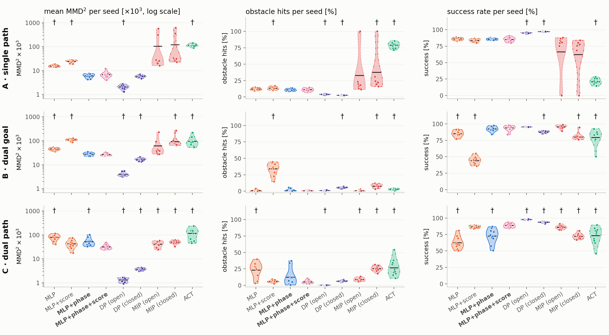
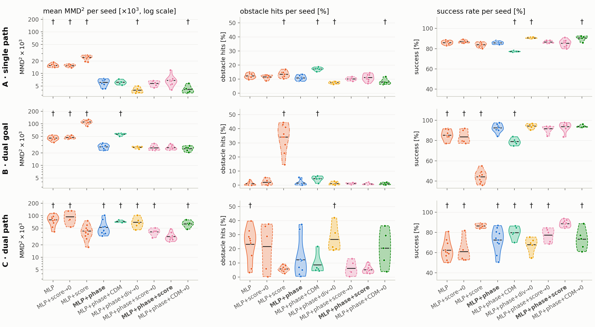

# Policy evaluation on the SE(2) skate scenarios

Generated by `scripts/skate/evaluate_policies.py`. Mean ± std over seeds.

* **methods** -- every method trains on the same demos and training subsets. FM, the MLP and the CDM arms share the network (3×256 SiLU MLP → skate controls `[v, ω]`) and the optimizer. The figures call FM **MLP+phase**, after its network (FM+CDM is MLP+phase+CDM, and so on):
  * **FM** -- phase-conditioned, `(pose, phase) → [v, ω]`, trained with the flow-matching loss `E|u − v|²`;
  * **FM+CDM (λ=…)** -- FM plus the conditional divergence matching regularizer at a constant weight, `L_FM + λ E|a + b|`, with `a = ∇·u − ∇·v` (the demos' kNN divergence minus the model's SE(2) divergence) and `b = (u − v)·∇log p_ρ` (the twist error against the demos' kernel score);
  * **MLP (no phase)** -- the same regression loss with no phase / flow-time input: a plain state-feedback policy `pose → [v, ω]` (behaviour cloning);
  * **FM+div, FM+score, FM+CDM (λ 0.05→0)** -- the CDM ablation, each term alone and both together: the regularizer is `E|a|`, `E|b|` or `E|a + b|`, and λ follows a cosine from 0.05 to 0 over the first 50% of training, then pure FM. `∇·v` is the trace over the forward and yaw body directions, the only ones a skate can drive, and `b` never sees the score's lateral row: both twists' lateral slot is zero;
  * **MLP+score (λ 0.05→0)** -- the phase ablation of the annealed regularizer: the MLP's network, which never sees the phase, trained with FM+score's regularizer and schedule. The score is still that of the demos at the row's phase -- a training-time signal only;
  * **FM+chunk** -- FM with action chunking: the same network, loss, optimizer and steps, but from `(pose, phase)` it predicts the next 16 controls and executes the first 8 before re-planning, like Diffusion Policy and MIP; trained at the largest n only, with no regularizer. Its divergence is that of the chunk's first control;
  * **FM+chunk+score (λ 0.05→0)** -- FM+chunk with the score regularizer on every control of the chunk: the predicted chunk is integrated open loop from the demo pose (the exact, saturated arc a rollout drives), giving states `x̂⁽ʲ⁾`, and control `j` pays `|(u_{k+j} − v⁽ʲ⁾)·∇log p_{ρ_{k+j}}(x̂⁽ʲ⁾)|` -- its demo control's twist error against the kernel score of the training demos at its own phase, evaluated at the state it would actually be executed from. The terms are averaged over the 16 controls (as the regression loss is), `x̂` is not backpropagated through, and λ follows FM+score's cosine to 0 over the first 50% of training;
  * **…+TE** (FM+chunk, FM+chunk+score (λ 0.05→0), Diffusion Policy, MIP, ACT) -- the same trained policies, re-evaluated with ACT's temporal ensembling instead of executing 8 controls per chunk: a chunk is predicted at every control step, and the control executed at step `t` is the weighted mean of every prediction made so far for `t`, weights `exp(−m·i)` with `i = 0` the oldest and m = 0.01 (ACT's default). Nothing is retrained; the held-out starts, clamping and sampling seeds are the original evaluation's;
  * **Diffusion Policy, MIP, MeanFlow** -- the generative baselines, trained at the largest n only. From the last two poses (no phase) each samples a chunk of 16 controls and executes the first 8 before re-planning. Diffusion Policy is a 100-step DDPM on its 1D temporal UNet; MIP (Much Ado About Noising) is two regression steps on its residual MLP, the second from the first's output with noise injected in training; MeanFlow is a one-step average-velocity model on the Diffusion Policy UNet. Each keeps its own paper's optimizer, batch size and EMA (evaluated with the EMA weights) over a shared step budget. They have no velocity field of their own, so the divergence figure shows only their rollouts.
* **MMD** -- squared MMD ×10³ between rollouts and held-out demos, averaged over phase (lower is better).
* **obstacle / wall** -- rollouts that come within the robot radius of an obstacle / the world boundary.
* **success** -- reaches a goal (within 3σ) with no collision of either kind.
* **modes** -- fraction of rollouts per homotopy class (demos are 50/50).
* **execution** -- commanded controls are saturated to the planner's `SkateLimits` (v ∈ [0, 2] m/s, |ω| ≤ 2 rad/s) before the robot executes them; collisions and all metrics are measured on the path actually driven. **saturated** is the share of rollouts whose commands left that box (beyond the demos' 0.05 tolerance) at least once.
* **p** -- Welch t-test against FM over seeds; bold if < 0.05.

## At a glance

Means over seeds; best of the methods in bold; † p < 0.05 against FM; — not trained.

**MMD×10³**

| scen. | n | FM | FM+CDM (λ=0.05) | MLP (no phase) | MLP+score (λ 0.05→0) | MLP+score (λ=0.5) | FM+div (λ 0.05→0) | FM+score (λ 0.05→0) | FM+score (λ=0.5) | FM+CDM (λ 0.05→0) | FM+chunk | FM+chunk+TE | FM+chunk+score (λ 0.05→0) | FM+chunk+score (λ 0.05→0)+TE | Diffusion Policy | Diffusion Policy+TE | MIP | MIP+TE | ACT | ACT+TE |
|---|---:|---:|---:|---:|---:|---:|---:|---:|---:|---:|---:|---:|---:|---:|---:|---:|---:|---:|---:|---:|
| A | 1024 | 6.1 | 6.2 | 15.7† | 15.5† | 24.4† | 4.0† | 5.8 | 6.8 | 4.1† | 13.6† | 21.4† | 15.5† | 22.6† | **2.1†** | 5.7 | 105.6 | 120.1 | 70.6† | 116.9† |
| A | 512 | 7.0 | 6.8 | 15.6† | 15.7† | — | **4.5†** | 6.6 | — | 5.4 | — | — | — | — | — | — | — | — | — | — |
| A | 256 | 6.0 | 10.1† | 13.8† | 14.5† | — | **5.0** | 6.8 | — | 5.6 | — | — | — | — | — | — | — | — | — | — |
| A | 128 | 6.2 | 11.9 | 14.6† | 15.3† | — | 7.0 | 6.7 | — | **4.7** | — | — | — | — | — | — | — | — | — | — |
| A | 64 | 10.1 | 23.2† | 14.2 | 15.4 | — | 11.7 | 10.1 | — | **10.0** | — | — | — | — | — | — | — | — | — | — |
| B | 1024 | 27.9 | 56.4† | 45.6† | 47.0† | 110.6† | 27.3 | 26.6 | 26.7 | 25.4 | 143.3† | 302.5† | 172.2† | 308.2† | **4.0†** | 16.6† | 61.2 | 93.2† | 157.0† | 96.1† |
| B | 512 | 32.5 | 61.0† | 52.2† | 48.3 | — | **27.3** | 34.4 | — | 29.3 | — | — | — | — | — | — | — | — | — | — |
| B | 256 | 36.7 | 42.0 | 55.6† | 59.7† | — | 30.3 | 34.4 | — | **29.7** | — | — | — | — | — | — | — | — | — | — |
| B | 128 | 34.7 | 52.3 | 70.6 | 55.0 | — | 37.2 | 33.0 | — | **32.4** | — | — | — | — | — | — | — | — | — | — |
| B | 64 | **41.5** | 67.8 | 86.6 | 88.6 | — | 57.5 | 44.9 | — | 44.2 | — | — | — | — | — | — | — | — | — | — |
| C | 1024 | 52.4 | 72.5† | 80.1† | 94.7† | 42.6 | 69.8 | 41.0 | 31.4† | 63.8 | 102.4† | 307.7† | 127.3† | 279.6† | **1.3†** | 3.7† | 41.5 | 49.8 | 146.3† | 116.1† |
| C | 512 | **50.9** | 71.4 | 92.5 | 103.3† | — | 86.7† | 52.9 | — | 83.4 | — | — | — | — | — | — | — | — | — | — |
| C | 256 | **61.4** | 79.5 | 78.5 | 79.1 | — | 81.8 | 62.7 | — | 80.0 | — | — | — | — | — | — | — | — | — | — |
| C | 128 | 97.7 | **85.2** | 131.0 | 113.0 | — | 119.7 | 103.8 | — | 105.0 | — | — | — | — | — | — | — | — | — | — |
| C | 64 | **56.4** | 94.4 | 71.9 | 75.9 | — | 109.1 | 67.9 | — | 81.5 | — | — | — | — | — | — | — | — | — | — |

**success %**

| scen. | n | FM | FM+CDM (λ=0.05) | MLP (no phase) | MLP+score (λ 0.05→0) | MLP+score (λ=0.5) | FM+div (λ 0.05→0) | FM+score (λ 0.05→0) | FM+score (λ=0.5) | FM+CDM (λ 0.05→0) | FM+chunk | FM+chunk+TE | FM+chunk+score (λ 0.05→0) | FM+chunk+score (λ 0.05→0)+TE | Diffusion Policy | Diffusion Policy+TE | MIP | MIP+TE | ACT | ACT+TE |
|---|---:|---:|---:|---:|---:|---:|---:|---:|---:|---:|---:|---:|---:|---:|---:|---:|---:|---:|---:|---:|
| A | 1024 | 86 | 77† | 86 | 87 | 84† | 91† | 87 | 85 | 91† | 96† | 95† | 95† | 96† | 95† | **97†** | 66 | 62 | 31† | 21† |
| A | 512 | 86 | 75† | 86 | 86 | — | 89 | 87 | — | **89†** | — | — | — | — | — | — | — | — | — | — |
| A | 256 | 84 | 69† | 87 | **87** | — | **87** | 85 | — | 86 | — | — | — | — | — | — | — | — | — | — |
| A | 128 | 84 | 60† | 87 | **88†** | — | 85 | 85 | — | 86 | — | — | — | — | — | — | — | — | — | — |
| A | 64 | 78 | 47† | 85 | **85** | — | 77 | 78 | — | 76 | — | — | — | — | — | — | — | — | — | — |
| B | 1024 | 93 | 79† | 85† | 84† | 44† | 94 | 92 | 94 | 94 | 82† | 6† | 80† | 8† | 95† | 88† | **96** | 80† | 95 | 79† |
| B | 512 | 90 | 77† | 84 | 85 | — | 91 | 90 | — | **93** | — | — | — | — | — | — | — | — | — | — |
| B | 256 | 85 | 70† | 84 | 85 | — | 88 | 87 | — | **91** | — | — | — | — | — | — | — | — | — | — |
| B | 128 | 86 | 54† | 80 | 83 | — | 81 | 86 | — | **88** | — | — | — | — | — | — | — | — | — | — |
| B | 64 | **69** | 37† | 65 | 66 | — | 57 | 62 | — | 66 | — | — | — | — | — | — | — | — | — | — |
| C | 1024 | 72 | 80 | 63† | 61 | 87† | 68 | 77 | 89† | 73 | 55† | 2† | 50 | 3† | **98†** | 94† | 86† | 72 | 49† | 73 |
| C | 512 | 70 | 70 | 59 | 58 | — | 66 | **72** | — | 71 | — | — | — | — | — | — | — | — | — | — |
| C | 256 | 62 | 46† | 59 | **63** | — | 63 | 63 | — | 61 | — | — | — | — | — | — | — | — | — | — |
| C | 128 | **54** | 45 | 47 | 48 | — | 41 | 50 | — | 44 | — | — | — | — | — | — | — | — | — | — |
| C | 64 | 58 | 36† | **62** | 53 | — | 43 | 56 | — | 47 | — | — | — | — | — | — | — | — | — | — |

**obstacle %**

| scen. | n | FM | FM+CDM (λ=0.05) | MLP (no phase) | MLP+score (λ 0.05→0) | MLP+score (λ=0.5) | FM+div (λ 0.05→0) | FM+score (λ 0.05→0) | FM+score (λ=0.5) | FM+CDM (λ 0.05→0) | FM+chunk | FM+chunk+TE | FM+chunk+score (λ 0.05→0) | FM+chunk+score (λ 0.05→0)+TE | Diffusion Policy | Diffusion Policy+TE | MIP | MIP+TE | ACT | ACT+TE |
|---|---:|---:|---:|---:|---:|---:|---:|---:|---:|---:|---:|---:|---:|---:|---:|---:|---:|---:|---:|---:|
| A | 1024 | 11 | 17† | 12 | 12 | 13† | 8† | 10 | 11 | 8† | 4† | 5† | 5† | 4† | 4† | **3†** | 33 | 38† | 69† | 79† |
| A | 512 | 12 | 20† | 13 | 12 | — | 9 | 11 | — | **8** | — | — | — | — | — | — | — | — | — | — |
| A | 256 | 12 | 22† | 11 | 11 | — | **10** | 11 | — | 11 | — | — | — | — | — | — | — | — | — | — |
| A | 128 | 12 | 30† | 10 | 10 | — | 9 | 10 | — | **9** | — | — | — | — | — | — | — | — | — | — |
| A | 64 | 18 | 45† | 13 | **13** | — | 17 | 18 | — | 18 | — | — | — | — | — | — | — | — | — | — |
| B | 1024 | 1 | 5† | 1 | 2 | 34† | 1 | 1 | 1 | 1 | 6† | 51† | 8† | 38† | 1 | 5† | **1** | 8† | 2 | 3 |
| B | 512 | 2 | 5 | 1 | 1 | — | 2 | 2 | — | **1** | — | — | — | — | — | — | — | — | — | — |
| B | 256 | 3 | 10 | 4 | **1** | — | 3 | 3 | — | 2† | — | — | — | — | — | — | — | — | — | — |
| B | 128 | 6 | 19 | 3 | **3** | — | 9 | 6 | — | 6 | — | — | — | — | — | — | — | — | — | — |
| B | 64 | 13 | 39† | **8** | 8 | — | 19 | 16 | — | 16 | — | — | — | — | — | — | — | — | — | — |
| C | 1024 | 12 | 9 | 23 | 22 | 6 | 27† | 6 | 5 | 20 | 44† | 98† | 50† | 97† | **0†** | 6 | 9 | 26† | 51† | 27† |
| C | 512 | 15 | **14** | 16 | 26 | — | 27 | 15 | — | 24 | — | — | — | — | — | — | — | — | — | — |
| C | 256 | 21 | 23 | 19 | **15** | — | 26 | 19 | — | 23 | — | — | — | — | — | — | — | — | — | — |
| C | 128 | 28 | 24 | **23** | 25 | — | 37 | 31 | — | 37 | — | — | — | — | — | — | — | — | — | — |
| C | 64 | **22** | 31 | 24 | 30 | — | 29 | 29 | — | 35 | — | — | — | — | — | — | — | — | — | — |

## Inference cost

Median of repeated calls on the trained policies. A **decision** is one action for FM and the MLP, and one 8-step action chunk for FM+chunk and the generative baselines, which re-plan only once the chunk has been executed — so the per-step cost is what a robot pays at each control tick, and the rate in brackets is what that latency allows (the demonstrations run at 6.7 Hz); the dashed lines mark two latency budgets, a 60 Hz visual-feedback loop and a 1 kHz tactile one, and a bar that ends left of a line fits inside that budget. The last panel puts success against that cost — the point is a method's mean over **all three scenarios** at the largest training-set size (each already a mean over its seeds) and the whisker spans the individual scenarios, so a method that carries its average on two tasks and fails the third shows a long whisker. The policy is the same on both devices, so a method's two points differ only in what the hardware costs it. Diffusion Policy and MIP appear twice there: as trained, running each 8-step chunk open loop between re-plans (circles), and closed loop with ACT's temporal ensembling (their +TE re-evaluations, squares), which predicts a chunk at every control step and so pays a whole decision per step. MLP+phase+score (and MLP+phase+chunk+score) is not timed on its own: its regularizer only acts in training, so at inference it runs MLP+phase's (MLP+phase+chunk's) network unchanged and is plotted at that measured cost.

**NVIDIA GeForce RTX 4090** (torch 2.1.2+cu121)

| method | params | net calls per decision | ms per decision (batch 1) | ms per control step (batch 1) | ms per decision (batch 1024) | s per 50-step rollout (batch 1024) |
|---|---:|---:|---:|---:|---:|---:|
| FM | 0.13 M | 1 | 0.17 | 0.17 | 0.2 | 0.02 |
| MLP (no phase) | 0.13 M | 1 | 0.15 | 0.15 | 0.2 | 0.02 |
| FM+chunk | 0.14 M | 1 | 0.21 | 0.03 | 0.2 | 0.02 |
| Diffusion Policy | 65.32 M | 100 | 439.06 | 54.88 | 1233.3 | 8.64 |
| MIP | 18.32 M | 2 | 2.20 | 0.28 | 3.1 | 0.04 |
| ACT | 40.12 M | 1 | 2.02 | 0.25 | 9.6 | 0.09 |

**AMD Ryzen 7 5700X 8-Core Processor (8 threads)** (torch 2.1.2+cu121)

| method | params | net calls per decision | ms per decision (batch 1) | ms per control step (batch 1) | ms per decision (batch 64) | s per 50-step rollout (batch 64) |
|---|---:|---:|---:|---:|---:|---:|
| FM | 0.13 M | 1 | 0.10 | 0.10 | 0.2 | 0.02 |
| MLP (no phase) | 0.13 M | 1 | 0.09 | 0.09 | 0.2 | 0.02 |
| FM+chunk | 0.14 M | 1 | 0.09 | 0.01 | 0.2 | 0.01 |
| Diffusion Policy | 65.32 M | 100 | 3422.63 | 427.83 | 9381.4 | 65.86 |
| MIP | 18.32 M | 2 | 6.99 | 0.87 | 12.3 | 0.09 |
| ACT | 40.12 M | 1 | 5.06 | 0.63 | 649.4 | 4.78 |

## All metrics

| scen. | n | method | seeds | MMD×10³ | obstacle % | wall % | success % | modes % | saturated % | div MAE [1/s] | p (MMD) | p (success) |
|---|---:|---|---:|---:|---:|---:|---:|---|---:|---:|---:|---:|
| A | 1024 | FM | 10 | 6.08 ± 1.16 | 10.9 ± 1.8 | 0.1 ± 0.1 | 85.8 ± 1.3 | 100 | 2.8 ± 0.8 | 0.268 ± 0.016 | — | — |
| A | 1024 | FM+CDM (λ=0.05) | 5 | 6.20 ± 0.76 | 17.2 ± 1.2 | 0.1 ± 0.1 | 77.3 ± 0.5 | 100 | 2.8 ± 1.6 | 0.125 ± 0.010 | 0.812 | **0.000** |
| A | 1024 | MLP (no phase) | 10 | 15.68 ± 1.53 | 12.4 ± 1.6 | 0.0 ± 0.0 | 86.0 ± 1.7 | 100 | 2.5 ± 0.9 | 0.256 ± 0.017 | **0.000** | 0.673 |
| A | 1024 | MLP+score (λ 0.05→0) | 5 | 15.50 ± 1.22 | 11.6 ± 1.7 | 0.0 ± 0.0 | 86.9 ± 1.5 | 100 | 2.6 ± 0.5 | 0.262 ± 0.023 | **0.000** | 0.185 |
| A | 1024 | MLP+score (λ=0.5) | 10 | 24.39 ± 3.05 | 13.5 ± 2.2 | 0.1 ± 0.1 | 83.9 ± 2.2 | 100 | 2.2 ± 2.0 | 0.237 ± 0.018 | **0.000** | **0.036** |
| A | 1024 | FM+div (λ 0.05→0) | 5 | 3.97 ± 0.66 | 7.5 ± 0.8 | 0.2 ± 0.2 | 90.6 ± 0.6 | 100 | 1.6 ± 0.8 | 0.174 ± 0.026 | **0.001** | **0.000** |
| A | 1024 | FM+score (λ 0.05→0) | 5 | 5.80 ± 0.89 | 10.1 ± 1.2 | 0.1 ± 0.3 | 86.6 ± 1.4 | 100 | 3.0 ± 0.4 | 0.245 ± 0.016 | 0.605 | 0.310 |
| A | 1024 | FM+score (λ=0.5) | 10 | 6.82 ± 2.07 | 11.1 ± 2.5 | 0.1 ± 0.1 | 85.3 ± 3.4 | 100 | 5.9 ± 2.2 | 0.227 ± 0.011 | 0.343 | 0.681 |
| A | 1024 | FM+CDM (λ 0.05→0) | 5 | 4.15 ± 0.97 | 8.0 ± 2.2 | 0.1 ± 0.1 | 90.6 ± 2.7 | 100 | 2.4 ± 0.8 | 0.183 ± 0.029 | **0.007** | **0.014** |
| A | 1024 | FM+chunk | 5 | 13.58 ± 1.98 | 3.8 ± 0.7 | 0.0 ± 0.0 | 96.2 ± 0.7 | 100 | 2.1 ± 0.7 | 0.241 ± 0.009 | **0.000** | **0.000** |
| A | 1024 | FM+chunk+TE | 5 | 21.41 ± 1.13 | 4.6 ± 0.7 | 0.0 ± 0.0 | 95.4 ± 0.7 | 100 | 2.1 ± 0.7 | 0.329 ± 0.020 | **0.000** | **0.000** |
| A | 1024 | FM+chunk+score (λ 0.05→0) | 5 | 15.46 ± 1.97 | 4.7 ± 0.4 | 0.0 ± 0.0 | 95.3 ± 0.4 | 100 | 1.9 ± 0.8 | 0.265 ± 0.023 | **0.000** | **0.000** |
| A | 1024 | FM+chunk+score (λ 0.05→0)+TE | 5 | 22.57 ± 1.38 | 4.1 ± 0.7 | 0.0 ± 0.0 | 95.8 ± 0.6 | 100 | 1.9 ± 0.8 | 0.341 ± 0.030 | **0.000** | **0.000** |
| A | 1024 | Diffusion Policy | 10 | 2.08 ± 0.41 | 4.0 ± 0.7 | 0.3 ± 0.1 | 95.0 ± 0.8 | 100 | 0.0 ± 0.0 | 0.117 ± 0.009 | **0.000** | **0.000** |
| A | 1024 | Diffusion Policy+TE | 10 | 5.70 ± 0.66 | 2.8 ± 0.3 | 0.0 ± 0.0 | 97.1 ± 0.3 | 100 | 0.0 ± 0.0 | 0.138 ± 0.005 | 0.383 | **0.000** |
| A | 1024 | MIP | 10 | 105.55 ± 185.95 | 33.0 ± 35.1 | 0.1 ± 0.2 | 66.5 ± 34.9 | 100 | 1.7 ± 2.9 | 0.272 ± 0.171 | 0.125 | 0.114 |
| A | 1024 | MIP+TE | 10 | 120.08 ± 203.20 | 37.6 ± 33.1 | 0.0 ± 0.0 | 62.3 ± 33.1 | 100 | 1.1 ± 2.6 | 0.285 ± 0.157 | 0.110 | 0.052 |
| A | 1024 | ACT | 10 | 70.63 ± 13.17 | 68.5 ± 8.3 | 0.0 ± 0.0 | 31.5 ± 8.3 | 100 | 13.4 ± 2.2 | 0.248 ± 0.030 | **0.000** | **0.000** |
| A | 1024 | ACT+TE | 10 | 116.86 ± 16.66 | 79.1 ± 4.7 | 0.0 ± 0.0 | 20.9 ± 4.7 | 100 | 10.3 ± 3.2 | 0.352 ± 0.019 | **0.000** | **0.000** |
| A | 512 | FM | 5 | 6.95 ± 1.54 | 11.5 ± 3.1 | 0.2 ± 0.3 | 85.6 ± 3.0 | 100 | 4.1 ± 0.8 | 0.255 ± 0.011 | — | — |
| A | 512 | FM+CDM (λ=0.05) | 5 | 6.76 ± 2.55 | 19.6 ± 2.6 | 0.1 ± 0.1 | 75.3 ± 2.5 | 100 | 3.1 ± 1.6 | 0.161 ± 0.023 | 0.886 | **0.000** |
| A | 512 | MLP (no phase) | 5 | 15.58 ± 0.91 | 12.7 ± 2.0 | 0.0 ± 0.0 | 86.2 ± 2.0 | 100 | 3.6 ± 1.3 | 0.262 ± 0.015 | **0.000** | 0.735 |
| A | 512 | MLP+score (λ 0.05→0) | 5 | 15.71 ± 1.70 | 12.5 ± 2.1 | 0.0 ± 0.0 | 85.9 ± 1.8 | 100 | 3.7 ± 1.2 | 0.261 ± 0.019 | **0.000** | 0.866 |
| A | 512 | FM+div (λ 0.05→0) | 5 | 4.50 ± 1.38 | 9.2 ± 2.7 | 0.2 ± 0.3 | 88.5 ± 4.0 | 100 | 3.4 ± 0.9 | 0.185 ± 0.024 | **0.029** | 0.234 |
| A | 512 | FM+score (λ 0.05→0) | 5 | 6.62 ± 1.16 | 10.7 ± 2.7 | 0.0 ± 0.0 | 87.0 ± 3.2 | 100 | 4.3 ± 1.5 | 0.244 ± 0.007 | 0.709 | 0.502 |
| A | 512 | FM+CDM (λ 0.05→0) | 5 | 5.44 ± 1.92 | 8.5 ± 1.3 | 0.1 ± 0.1 | 89.3 ± 1.3 | 100 | 3.3 ± 0.9 | 0.184 ± 0.022 | 0.208 | **0.048** |
| A | 256 | FM | 5 | 5.99 ± 1.10 | 12.5 ± 2.7 | 0.3 ± 0.2 | 83.5 ± 3.8 | 100 | 7.6 ± 2.1 | 0.249 ± 0.028 | — | — |
| A | 256 | FM+CDM (λ=0.05) | 5 | 10.05 ± 1.88 | 22.2 ± 3.3 | 0.2 ± 0.4 | 69.2 ± 3.1 | 100 | 10.1 ± 3.7 | 0.226 ± 0.040 | **0.005** | **0.000** |
| A | 256 | MLP (no phase) | 5 | 13.80 ± 1.97 | 10.7 ± 2.9 | 0.1 ± 0.2 | 87.1 ± 4.2 | 100 | 5.2 ± 1.3 | 0.252 ± 0.038 | **0.000** | 0.198 |
| A | 256 | MLP+score (λ 0.05→0) | 5 | 14.47 ± 1.59 | 11.1 ± 2.9 | 0.0 ± 0.0 | 87.2 ± 3.4 | 100 | 5.2 ± 1.7 | 0.252 ± 0.036 | **0.000** | 0.146 |
| A | 256 | FM+div (λ 0.05→0) | 5 | 5.01 ± 1.60 | 10.4 ± 2.9 | 0.4 ± 0.3 | 87.2 ± 2.8 | 100 | 4.1 ± 1.5 | 0.181 ± 0.029 | 0.295 | 0.124 |
| A | 256 | FM+score (λ 0.05→0) | 5 | 6.82 ± 1.75 | 10.5 ± 3.8 | 0.2 ± 0.2 | 84.9 ± 4.7 | 100 | 7.7 ± 2.4 | 0.251 ± 0.028 | 0.405 | 0.614 |
| A | 256 | FM+CDM (λ 0.05→0) | 5 | 5.56 ± 1.47 | 10.7 ± 3.8 | 0.4 ± 0.5 | 86.1 ± 4.2 | 100 | 5.3 ± 1.6 | 0.197 ± 0.036 | 0.612 | 0.342 |
| A | 128 | FM | 5 | 6.17 ± 1.26 | 11.6 ± 3.0 | 0.3 ± 0.4 | 84.2 ± 3.0 | 100 | 6.8 ± 2.6 | 0.267 ± 0.060 | — | — |
| A | 128 | FM+CDM (λ=0.05) | 5 | 11.87 ± 5.18 | 29.7 ± 1.2 | 0.5 ± 0.9 | 59.6 ± 2.8 | 100 | 18.6 ± 4.9 | 0.257 ± 0.040 | 0.068 | **0.000** |
| A | 128 | MLP (no phase) | 5 | 14.64 ± 1.23 | 10.4 ± 3.3 | 0.0 ± 0.0 | 87.1 ± 2.1 | 100 | 3.5 ± 1.3 | 0.241 ± 0.037 | **0.000** | 0.126 |
| A | 128 | MLP+score (λ 0.05→0) | 5 | 15.28 ± 2.01 | 9.7 ± 2.5 | 0.0 ± 0.0 | 88.5 ± 2.1 | 100 | 4.6 ± 1.6 | 0.245 ± 0.046 | **0.000** | **0.037** |
| A | 128 | FM+div (λ 0.05→0) | 5 | 7.00 ± 2.21 | 9.3 ± 2.0 | 0.1 ± 0.3 | 85.1 ± 2.6 | 100 | 6.8 ± 1.4 | 0.196 ± 0.029 | 0.492 | 0.628 |
| A | 128 | FM+score (λ 0.05→0) | 5 | 6.66 ± 1.80 | 10.3 ± 2.0 | 0.2 ± 0.3 | 84.9 ± 1.4 | 100 | 6.5 ± 2.5 | 0.253 ± 0.043 | 0.636 | 0.657 |
| A | 128 | FM+CDM (λ 0.05→0) | 5 | 4.71 ± 1.76 | 9.1 ± 2.7 | 0.4 ± 0.8 | 86.2 ± 3.6 | 100 | 6.3 ± 1.7 | 0.195 ± 0.034 | 0.175 | 0.376 |
| A | 64 | FM | 5 | 10.05 ± 5.04 | 17.9 ± 5.9 | 0.7 ± 0.8 | 77.8 ± 7.4 | 100 | 10.4 ± 4.0 | 0.261 ± 0.063 | — | — |
| A | 64 | FM+CDM (λ=0.05) | 5 | 23.20 ± 3.15 | 45.5 ± 6.3 | 2.0 ± 2.4 | 47.2 ± 8.1 | 100 | 26.5 ± 2.2 | 0.383 ± 0.043 | **0.002** | **0.000** |
| A | 64 | MLP (no phase) | 5 | 14.25 ± 4.15 | 12.8 ± 4.1 | 0.2 ± 0.5 | 84.6 ± 4.2 | 100 | 7.5 ± 1.2 | 0.241 ± 0.088 | 0.191 | 0.122 |
| A | 64 | MLP+score (λ 0.05→0) | 5 | 15.36 ± 4.90 | 12.7 ± 4.3 | 0.0 ± 0.0 | 85.1 ± 4.4 | 100 | 7.4 ± 1.5 | 0.234 ± 0.088 | 0.130 | 0.104 |
| A | 64 | FM+div (λ 0.05→0) | 5 | 11.73 ± 4.13 | 17.1 ± 4.3 | 1.8 ± 2.4 | 77.4 ± 3.7 | 100 | 14.5 ± 3.1 | 0.203 ± 0.054 | 0.582 | 0.916 |
| A | 64 | FM+score (λ 0.05→0) | 5 | 10.12 ± 3.90 | 18.4 ± 7.2 | 0.9 ± 1.4 | 77.9 ± 7.7 | 100 | 10.0 ± 2.1 | 0.242 ± 0.060 | 0.982 | 0.981 |
| A | 64 | FM+CDM (λ 0.05→0) | 5 | 10.04 ± 1.93 | 18.4 ± 5.5 | 2.2 ± 2.1 | 75.8 ± 5.8 | 100 | 13.5 ± 7.3 | 0.230 ± 0.061 | 0.994 | 0.650 |
| B | 1024 | FM | 10 | 27.89 ± 3.94 | 1.5 ± 1.9 | 0.0 ± 0.1 | 92.5 ± 4.0 | 47/51 | 3.3 ± 2.7 | 0.591 ± 0.027 | — | — |
| B | 1024 | FM+CDM (λ=0.05) | 5 | 56.44 ± 3.73 | 4.6 ± 2.0 | 0.3 ± 0.2 | 79.0 ± 3.4 | 46/48 | 2.5 ± 1.6 | 0.268 ± 0.011 | **0.000** | **0.000** |
| B | 1024 | MLP (no phase) | 10 | 45.56 ± 5.55 | 1.0 ± 1.3 | 0.1 ± 0.1 | 85.2 ± 5.3 | 46/49 | 2.0 ± 1.6 | 0.551 ± 0.045 | **0.000** | **0.003** |
| B | 1024 | MLP+score (λ 0.05→0) | 5 | 46.98 ± 4.17 | 2.0 ± 2.3 | 0.6 ± 1.0 | 83.7 ± 6.9 | 47/48 | 2.6 ± 2.0 | 0.554 ± 0.046 | **0.000** | **0.041** |
| B | 1024 | MLP+score (λ=0.5) | 10 | 110.60 ± 11.39 | 34.2 ± 9.7 | 20.9 ± 15.7 | 44.2 ± 5.9 | 47/53 | 13.0 ± 11.9 | 0.524 ± 0.032 | **0.000** | **0.000** |
| B | 1024 | FM+div (λ 0.05→0) | 5 | 27.25 ± 1.56 | 1.2 ± 1.1 | 0.0 ± 0.0 | 94.3 ± 2.4 | 48/51 | 1.0 ± 0.8 | 0.606 ± 0.035 | 0.663 | 0.310 |
| B | 1024 | FM+score (λ 0.05→0) | 5 | 26.56 ± 4.39 | 1.1 ± 0.5 | 0.0 ± 0.0 | 91.7 ± 4.1 | 48/50 | 3.0 ± 3.1 | 0.598 ± 0.026 | 0.583 | 0.735 |
| B | 1024 | FM+score (λ=0.5) | 10 | 26.74 ± 3.21 | 0.8 ± 0.6 | 0.0 ± 0.1 | 93.8 ± 4.2 | 45/54 | 0.7 ± 0.5 | 0.535 ± 0.043 | 0.482 | 0.480 |
| B | 1024 | FM+CDM (λ 0.05→0) | 5 | 25.38 ± 3.52 | 1.0 ± 0.8 | 0.0 ± 0.0 | 93.9 ± 1.3 | 47/52 | 0.9 ± 0.5 | 0.595 ± 0.035 | 0.243 | 0.331 |
| B | 1024 | FM+chunk | 5 | 143.33 ± 36.85 | 6.3 ± 3.2 | 0.2 ± 0.5 | 82.4 ± 3.8 | 44/49 | 4.8 ± 4.7 | 0.871 ± 0.044 | **0.002** | **0.001** |
| B | 1024 | FM+chunk+TE | 5 | 302.48 ± 9.94 | 50.7 ± 15.3 | 4.6 ± 5.8 | 5.9 ± 1.4 | 27/28 | 14.9 ± 14.2 | 0.555 ± 0.036 | **0.000** | **0.000** |
| B | 1024 | FM+chunk+score (λ 0.05→0) | 5 | 172.17 ± 20.38 | 8.2 ± 3.0 | 0.1 ± 0.3 | 80.1 ± 6.8 | 46/48 | 5.5 ± 1.9 | 0.906 ± 0.068 | **0.000** | **0.011** |
| B | 1024 | FM+chunk+score (λ 0.05→0)+TE | 5 | 308.19 ± 16.90 | 37.5 ± 13.2 | 4.6 ± 4.7 | 8.2 ± 4.3 | 33/19 | 15.5 ± 13.2 | 0.620 ± 0.040 | **0.000** | **0.000** |
| B | 1024 | Diffusion Policy | 10 | 4.00 ± 0.76 | 0.9 ± 0.4 | 0.2 ± 0.1 | 95.4 ± 0.3 | 50/50 | 0.0 ± 0.0 | 0.136 ± 0.014 | **0.000** | **0.047** |
| B | 1024 | Diffusion Policy+TE | 10 | 16.55 ± 2.14 | 5.4 ± 1.0 | 0.0 ± 0.1 | 87.6 ± 1.5 | 51/49 | 0.0 ± 0.0 | 0.245 ± 0.009 | **0.000** | **0.004** |
| B | 1024 | MIP | 10 | 61.25 ± 61.58 | 0.7 ± 0.8 | 0.0 ± 0.0 | 95.7 ± 2.8 | 42/58 | 0.0 ± 0.1 | 0.482 ± 0.128 | 0.121 | 0.054 |
| B | 1024 | MIP+TE | 10 | 93.15 ± 62.27 | 7.8 ± 2.8 | 0.0 ± 0.0 | 80.2 ± 5.4 | 51/48 | 0.0 ± 0.0 | 0.547 ± 0.087 | **0.009** | **0.000** |
| B | 1024 | ACT | 10 | 157.03 ± 92.95 | 1.5 ± 1.3 | 0.0 ± 0.0 | 95.0 ± 3.5 | 31/69 | 0.0 ± 0.0 | 0.704 ± 0.047 | **0.002** | 0.161 |
| B | 1024 | ACT+TE | 10 | 96.12 ± 50.94 | 2.7 ± 1.4 | 0.0 ± 0.0 | 79.5 ± 11.7 | 47/52 | 0.0 ± 0.0 | 0.660 ± 0.053 | **0.002** | **0.007** |
| B | 512 | FM | 5 | 32.45 ± 10.04 | 2.4 ± 1.9 | 0.1 ± 0.2 | 89.9 ± 4.7 | 48/51 | 4.9 ± 2.6 | 0.609 ± 0.025 | — | — |
| B | 512 | FM+CDM (λ=0.05) | 5 | 60.99 ± 9.29 | 5.2 ± 2.8 | 0.1 ± 0.1 | 77.1 ± 8.2 | 46/48 | 4.1 ± 3.6 | 0.268 ± 0.009 | **0.002** | **0.022** |
| B | 512 | MLP (no phase) | 5 | 52.21 ± 14.98 | 1.2 ± 2.1 | 0.4 ± 0.6 | 84.2 ± 5.9 | 45/52 | 2.1 ± 2.3 | 0.558 ± 0.057 | **0.044** | 0.126 |
| B | 512 | MLP+score (λ 0.05→0) | 5 | 48.32 ± 13.11 | 1.3 ± 1.1 | 0.3 ± 0.3 | 84.6 ± 4.3 | 45/51 | 2.6 ± 2.5 | 0.555 ± 0.038 | 0.066 | 0.098 |
| B | 512 | FM+div (λ 0.05→0) | 5 | 27.32 ± 4.44 | 1.9 ± 1.9 | 0.0 ± 0.1 | 90.5 ± 2.5 | 46/53 | 2.2 ± 1.4 | 0.587 ± 0.041 | 0.339 | 0.808 |
| B | 512 | FM+score (λ 0.05→0) | 5 | 34.40 ± 9.75 | 2.1 ± 1.3 | 0.2 ± 0.2 | 90.5 ± 4.1 | 45/54 | 2.9 ± 1.2 | 0.626 ± 0.028 | 0.764 | 0.844 |
| B | 512 | FM+CDM (λ 0.05→0) | 5 | 29.30 ± 5.26 | 1.1 ± 1.4 | 0.1 ± 0.1 | 93.3 ± 3.2 | 47/52 | 0.7 ± 0.5 | 0.604 ± 0.035 | 0.557 | 0.224 |
| B | 256 | FM | 5 | 36.73 ± 12.64 | 3.5 ± 1.1 | 1.4 ± 1.9 | 84.7 ± 3.2 | 41/55 | 6.2 ± 3.0 | 0.628 ± 0.027 | — | — |
| B | 256 | FM+CDM (λ=0.05) | 5 | 41.96 ± 11.51 | 10.0 ± 5.4 | 0.8 ± 0.5 | 70.3 ± 7.0 | 41/47 | 11.8 ± 5.6 | 0.257 ± 0.031 | 0.513 | **0.007** |
| B | 256 | MLP (no phase) | 5 | 55.61 ± 8.97 | 3.5 ± 3.8 | 0.4 ± 0.3 | 83.7 ± 4.9 | 42/55 | 4.4 ± 5.2 | 0.612 ± 0.091 | **0.029** | 0.720 |
| B | 256 | MLP+score (λ 0.05→0) | 5 | 59.70 ± 15.52 | 1.2 ± 2.3 | 0.4 ± 0.4 | 85.4 ± 4.4 | 43/53 | 2.3 ± 2.4 | 0.578 ± 0.036 | **0.034** | 0.770 |
| B | 256 | FM+div (λ 0.05→0) | 5 | 30.34 ± 11.38 | 3.3 ± 1.6 | 0.4 ± 0.3 | 88.3 ± 4.8 | 42/53 | 6.8 ± 2.9 | 0.590 ± 0.049 | 0.426 | 0.201 |
| B | 256 | FM+score (λ 0.05→0) | 5 | 34.36 ± 12.15 | 3.2 ± 2.6 | 0.8 ± 1.5 | 86.6 ± 4.3 | 41/55 | 5.2 ± 4.2 | 0.586 ± 0.040 | 0.770 | 0.439 |
| B | 256 | FM+CDM (λ 0.05→0) | 5 | 29.66 ± 11.26 | 1.6 ± 0.4 | 0.2 ± 0.2 | 90.5 ± 4.6 | 44/53 | 3.8 ± 2.1 | 0.571 ± 0.044 | 0.378 | 0.051 |
| B | 128 | FM | 5 | 34.68 ± 15.80 | 6.5 ± 6.1 | 2.2 ± 2.0 | 85.7 ± 3.7 | 47/50 | 8.3 ± 3.0 | 0.548 ± 0.004 | — | — |
| B | 128 | FM+CDM (λ=0.05) | 5 | 52.32 ± 11.06 | 18.6 ± 10.2 | 2.2 ± 2.1 | 54.3 ± 3.3 | 43/37 | 28.0 ± 4.7 | 0.322 ± 0.042 | 0.079 | **0.000** |
| B | 128 | MLP (no phase) | 5 | 70.65 ± 37.88 | 2.8 ± 3.3 | 1.1 ± 1.9 | 79.8 ± 8.0 | 40/53 | 7.5 ± 5.8 | 0.526 ± 0.030 | 0.104 | 0.193 |
| B | 128 | MLP+score (λ 0.05→0) | 5 | 55.02 ± 15.28 | 2.8 ± 3.5 | 1.1 ± 2.0 | 83.2 ± 7.1 | 45/51 | 5.6 ± 5.6 | 0.505 ± 0.061 | 0.072 | 0.511 |
| B | 128 | FM+div (λ 0.05→0) | 5 | 37.18 ± 14.32 | 8.7 ± 6.2 | 1.6 ± 2.4 | 80.9 ± 6.2 | 46/47 | 13.1 ± 2.4 | 0.527 ± 0.052 | 0.800 | 0.184 |
| B | 128 | FM+score (λ 0.05→0) | 5 | 32.98 ± 10.25 | 5.8 ± 6.1 | 2.5 ± 2.4 | 86.3 ± 3.4 | 47/49 | 9.5 ± 2.2 | 0.561 ± 0.040 | 0.846 | 0.769 |
| B | 128 | FM+CDM (λ 0.05→0) | 5 | 32.44 ± 16.06 | 5.9 ± 4.7 | 0.8 ± 0.7 | 87.7 ± 4.6 | 49/50 | 7.7 ± 5.3 | 0.544 ± 0.082 | 0.829 | 0.463 |
| B | 64 | FM | 5 | 41.53 ± 36.99 | 12.8 ± 3.6 | 1.3 ± 2.5 | 69.5 ± 13.8 | 47/42 | 18.2 ± 13.5 | 0.489 ± 0.089 | — | — |
| B | 64 | FM+CDM (λ=0.05) | 5 | 67.84 ± 21.23 | 38.8 ± 13.7 | 4.7 ± 7.3 | 37.5 ± 6.9 | 34/37 | 40.9 ± 9.5 | 0.441 ± 0.073 | 0.214 | **0.004** |
| B | 64 | MLP (no phase) | 5 | 86.60 ± 65.53 | 8.1 ± 5.8 | 1.6 ± 2.7 | 64.7 ± 21.0 | 41/51 | 13.4 ± 9.1 | 0.582 ± 0.127 | 0.227 | 0.687 |
| B | 64 | MLP+score (λ 0.05→0) | 5 | 88.59 ± 55.77 | 8.4 ± 9.3 | 3.0 ± 4.8 | 65.8 ± 17.8 | 47/43 | 15.7 ± 10.2 | 0.623 ± 0.170 | 0.160 | 0.728 |
| B | 64 | FM+div (λ 0.05→0) | 5 | 57.48 ± 61.28 | 19.1 ± 10.3 | 4.3 ± 3.1 | 56.9 ± 19.9 | 38/38 | 33.2 ± 22.5 | 0.461 ± 0.068 | 0.635 | 0.282 |
| B | 64 | FM+score (λ 0.05→0) | 5 | 44.91 ± 34.88 | 16.4 ± 5.0 | 3.6 ± 5.1 | 62.2 ± 10.5 | 42/36 | 23.5 ± 6.1 | 0.546 ± 0.088 | 0.885 | 0.381 |
| B | 64 | FM+CDM (λ 0.05→0) | 5 | 44.21 ± 31.67 | 15.6 ± 6.5 | 1.5 ± 1.4 | 65.8 ± 6.8 | 40/46 | 20.3 ± 8.7 | 0.533 ± 0.090 | 0.905 | 0.617 |
| C | 1024 | FM | 10 | 52.42 ± 22.27 | 12.2 ± 13.2 | 8.4 ± 11.3 | 72.5 ± 11.5 | 49/51 | 5.9 ± 8.9 | 1.068 ± 0.084 | — | — |
| C | 1024 | FM+CDM (λ=0.05) | 5 | 72.45 ± 3.94 | 8.6 ± 7.3 | 4.8 ± 3.9 | 79.8 ± 6.4 | 52/47 | 7.6 ± 4.2 | 0.575 ± 0.122 | **0.020** | 0.138 |
| C | 1024 | MLP (no phase) | 10 | 80.14 ± 21.75 | 23.2 ± 11.6 | 21.1 ± 12.9 | 62.5 ± 9.3 | 43/56 | 22.5 ± 11.4 | 1.047 ± 0.135 | **0.011** | **0.048** |
| C | 1024 | MLP+score (λ 0.05→0) | 5 | 94.66 ± 34.06 | 21.7 ± 17.4 | 20.8 ± 17.4 | 61.0 ± 12.4 | 45/55 | 20.4 ± 17.7 | 1.087 ± 0.182 | **0.047** | 0.122 |
| C | 1024 | MLP+score (λ=0.5) | 10 | 42.62 ± 16.32 | 5.8 ± 1.9 | 3.6 ± 2.3 | 86.5 ± 2.0 | 46/54 | 3.1 ± 2.3 | 0.941 ± 0.049 | 0.278 | **0.004** |
| C | 1024 | FM+div (λ 0.05→0) | 5 | 69.77 ± 21.35 | 26.8 ± 9.8 | 8.8 ± 9.0 | 67.9 ± 7.9 | 51/49 | 16.8 ± 13.8 | 1.101 ± 0.039 | 0.180 | 0.384 |
| C | 1024 | FM+score (λ 0.05→0) | 5 | 41.04 ± 7.59 | 6.1 ± 5.1 | 2.0 ± 2.6 | 77.3 ± 7.1 | 53/45 | 2.6 ± 2.5 | 1.026 ± 0.072 | 0.171 | 0.333 |
| C | 1024 | FM+score (λ=0.5) | 10 | 31.43 ± 7.29 | 5.2 ± 2.6 | 2.1 ± 1.9 | 88.7 ± 3.1 | 50/50 | 0.4 ± 1.2 | 0.975 ± 0.066 | **0.016** | **0.001** |
| C | 1024 | FM+CDM (λ 0.05→0) | 5 | 63.85 ± 11.35 | 20.4 ± 13.1 | 9.4 ± 13.5 | 73.3 ± 10.7 | 48/52 | 18.1 ± 12.8 | 1.094 ± 0.062 | 0.211 | 0.894 |
| C | 1024 | FM+chunk | 5 | 102.39 ± 34.99 | 44.4 ± 10.3 | 14.9 ± 10.9 | 55.4 ± 10.2 | 53/47 | 27.3 ± 9.9 | 1.341 ± 0.063 | **0.029** | **0.016** |
| C | 1024 | FM+chunk+TE | 5 | 307.72 ± 24.75 | 97.7 ± 0.7 | 52.8 ± 24.2 | 2.3 ± 0.7 | 61/39 | 7.1 ± 7.2 | 1.264 ± 0.043 | **0.000** | **0.000** |
| C | 1024 | FM+chunk+score (λ 0.05→0) | 2 | 127.28 ± 3.07 | 49.6 ± 7.3 | 10.7 ± 1.3 | 50.3 ± 7.3 | 56/44 | 23.3 ± 7.0 | 1.524 ± 0.038 | **0.000** | 0.063 |
| C | 1024 | FM+chunk+score (λ 0.05→0)+TE | 2 | 279.65 ± 31.16 | 96.7 ± 1.9 | 46.7 ± 17.3 | 3.2 ± 1.9 | 62/38 | 27.6 ± 35.8 | 1.197 ± 0.030 | **0.042** | **0.000** |
| C | 1024 | Diffusion Policy | 10 | 1.32 ± 0.30 | 0.3 ± 0.1 | 0.0 ± 0.1 | 97.7 ± 0.5 | 50/50 | 0.0 ± 0.0 | 0.298 ± 0.013 | **0.000** | **0.000** |
| C | 1024 | Diffusion Policy+TE | 10 | 3.69 ± 0.40 | 6.3 ± 1.0 | 1.5 ± 0.5 | 93.5 ± 1.0 | 50/50 | 0.0 ± 0.0 | 0.485 ± 0.018 | **0.000** | **0.000** |
| C | 1024 | MIP | 10 | 41.51 ± 12.44 | 8.9 ± 2.6 | 0.3 ± 0.2 | 85.9 ± 2.8 | 47/53 | 0.2 ± 0.2 | 0.801 ± 0.059 | 0.197 | **0.005** |
| C | 1024 | MIP+TE | 10 | 49.80 ± 8.20 | 25.5 ± 4.0 | 1.1 ± 1.2 | 72.3 ± 4.1 | 49/51 | 0.0 ± 0.0 | 0.939 ± 0.042 | 0.733 | 0.959 |
| C | 1024 | ACT | 10 | 146.25 ± 76.41 | 50.6 ± 21.7 | 0.9 ± 0.8 | 49.4 ± 21.7 | 36/64 | 0.0 ± 0.0 | 0.818 ± 0.085 | **0.004** | **0.010** |
| C | 1024 | ACT+TE | 10 | 116.09 ± 60.92 | 26.7 ± 13.0 | 3.3 ± 2.0 | 73.3 ± 13.0 | 45/55 | 0.0 ± 0.0 | 1.069 ± 0.077 | **0.010** | 0.880 |
| C | 512 | FM | 5 | 50.94 ± 19.96 | 14.8 ± 11.6 | 12.0 ± 11.1 | 70.1 ± 13.1 | 48/51 | 10.0 ± 11.4 | 1.022 ± 0.089 | — | — |
| C | 512 | FM+CDM (λ=0.05) | 5 | 71.41 ± 9.48 | 14.0 ± 5.7 | 3.6 ± 4.2 | 70.3 ± 7.7 | 52/45 | 9.2 ± 4.4 | 0.638 ± 0.082 | 0.086 | 0.980 |
| C | 512 | MLP (no phase) | 5 | 92.51 ± 33.86 | 16.1 ± 15.0 | 12.6 ± 16.2 | 59.3 ± 14.4 | 48/52 | 12.0 ± 15.7 | 1.042 ± 0.201 | 0.053 | 0.250 |
| C | 512 | MLP+score (λ 0.05→0) | 5 | 103.26 ± 41.18 | 25.8 ± 17.7 | 23.6 ± 20.0 | 58.5 ± 11.5 | 42/58 | 22.9 ± 19.9 | 1.081 ± 0.188 | **0.045** | 0.174 |
| C | 512 | FM+div (λ 0.05→0) | 5 | 86.68 ± 13.24 | 27.0 ± 10.2 | 8.1 ± 13.8 | 66.0 ± 7.3 | 45/55 | 18.1 ± 12.3 | 1.072 ± 0.077 | **0.013** | 0.556 |
| C | 512 | FM+score (λ 0.05→0) | 5 | 52.92 ± 28.06 | 14.6 ± 16.0 | 10.6 ± 14.4 | 72.4 ± 15.0 | 43/56 | 11.3 ± 14.4 | 1.054 ± 0.115 | 0.901 | 0.804 |
| C | 512 | FM+CDM (λ 0.05→0) | 5 | 83.38 ± 25.16 | 24.3 ± 17.7 | 22.8 ± 19.1 | 71.0 ± 17.6 | 51/49 | 22.7 ± 15.2 | 1.107 ± 0.166 | 0.056 | 0.936 |
| C | 256 | FM | 5 | 61.37 ± 32.18 | 20.6 ± 12.5 | 13.7 ± 8.2 | 61.9 ± 11.4 | 51/47 | 22.8 ± 13.2 | 1.071 ± 0.182 | — | — |
| C | 256 | FM+CDM (λ=0.05) | 5 | 79.48 ± 21.05 | 22.8 ± 5.4 | 3.8 ± 1.1 | 45.6 ± 6.1 | 45/45 | 22.9 ± 5.0 | 0.728 ± 0.171 | 0.328 | **0.029** |
| C | 256 | MLP (no phase) | 5 | 78.50 ± 20.35 | 18.7 ± 12.6 | 21.4 ± 9.9 | 59.1 ± 5.7 | 56/44 | 22.7 ± 10.3 | 0.959 ± 0.111 | 0.349 | 0.640 |
| C | 256 | MLP+score (λ 0.05→0) | 5 | 79.12 ± 39.75 | 14.6 ± 15.6 | 15.9 ± 15.9 | 63.1 ± 7.6 | 51/49 | 16.3 ± 15.0 | 0.929 ± 0.106 | 0.461 | 0.856 |
| C | 256 | FM+div (λ 0.05→0) | 5 | 81.76 ± 54.76 | 26.3 ± 18.6 | 15.6 ± 14.7 | 62.7 ± 14.2 | 55/43 | 27.7 ± 18.5 | 1.072 ± 0.146 | 0.498 | 0.924 |
| C | 256 | FM+score (λ 0.05→0) | 5 | 62.71 ± 29.35 | 18.7 ± 8.0 | 6.8 ± 5.5 | 62.9 ± 8.2 | 53/40 | 17.7 ± 9.6 | 1.095 ± 0.125 | 0.947 | 0.885 |
| C | 256 | FM+CDM (λ 0.05→0) | 5 | 80.04 ± 49.66 | 23.0 ± 13.2 | 6.9 ± 2.8 | 61.3 ± 12.9 | 48/50 | 26.2 ± 14.8 | 1.094 ± 0.136 | 0.504 | 0.939 |
| C | 128 | FM | 5 | 97.68 ± 38.37 | 28.5 ± 13.5 | 17.3 ± 15.1 | 53.8 ± 7.1 | 47/46 | 22.9 ± 19.2 | 1.154 ± 0.085 | — | — |
| C | 128 | FM+CDM (λ=0.05) | 5 | 85.19 ± 17.52 | 24.2 ± 12.5 | 5.7 ± 4.1 | 45.1 ± 7.4 | 43/40 | 32.8 ± 13.7 | 0.816 ± 0.161 | 0.534 | 0.094 |
| C | 128 | MLP (no phase) | 5 | 130.99 ± 76.62 | 22.7 ± 16.3 | 10.6 ± 10.3 | 46.9 ± 15.3 | 33/64 | 17.8 ± 13.8 | 1.010 ± 0.195 | 0.419 | 0.398 |
| C | 128 | MLP+score (λ 0.05→0) | 5 | 113.03 ± 60.94 | 25.0 ± 16.7 | 14.9 ± 13.8 | 47.5 ± 16.6 | 45/53 | 18.3 ± 12.6 | 1.058 ± 0.176 | 0.649 | 0.469 |
| C | 128 | FM+div (λ 0.05→0) | 5 | 119.69 ± 59.82 | 37.0 ± 20.9 | 14.2 ± 4.7 | 41.1 ± 14.4 | 50/45 | 33.3 ± 21.7 | 1.165 ± 0.114 | 0.512 | 0.128 |
| C | 128 | FM+score (λ 0.05→0) | 5 | 103.77 ± 36.92 | 30.7 ± 16.2 | 11.3 ± 10.3 | 50.3 ± 12.9 | 50/46 | 28.0 ± 15.4 | 1.128 ± 0.086 | 0.805 | 0.610 |
| C | 128 | FM+CDM (λ 0.05→0) | 5 | 104.99 ± 53.11 | 37.5 ± 18.1 | 14.7 ± 11.4 | 44.2 ± 11.1 | 46/48 | 30.0 ± 19.1 | 1.164 ± 0.161 | 0.810 | 0.146 |
| C | 64 | FM | 5 | 56.42 ± 31.08 | 22.4 ± 16.0 | 4.2 ± 2.9 | 58.2 ± 17.4 | 50/46 | 22.6 ± 4.2 | 0.994 ± 0.173 | — | — |
| C | 64 | FM+CDM (λ=0.05) | 5 | 94.39 ± 50.15 | 31.1 ± 12.3 | 7.4 ± 6.8 | 35.9 ± 10.4 | 41/41 | 33.8 ± 18.6 | 1.027 ± 0.084 | 0.195 | **0.046** |
| C | 64 | MLP (no phase) | 5 | 71.90 ± 50.64 | 24.4 ± 21.3 | 17.0 ± 13.6 | 61.6 ± 25.5 | 59/39 | 24.0 ± 15.9 | 0.861 ± 0.127 | 0.579 | 0.815 |
| C | 64 | MLP+score (λ 0.05→0) | 5 | 75.95 ± 49.52 | 29.7 ± 14.1 | 17.8 ± 14.8 | 52.5 ± 21.1 | 60/39 | 32.4 ± 19.8 | 0.941 ± 0.139 | 0.480 | 0.655 |
| C | 64 | FM+div (λ 0.05→0) | 5 | 109.06 ± 81.90 | 28.7 ± 7.6 | 14.9 ± 10.2 | 42.7 ± 16.2 | 41/53 | 32.2 ± 14.0 | 1.135 ± 0.207 | 0.235 | 0.185 |
| C | 64 | FM+score (λ 0.05→0) | 5 | 67.86 ± 59.06 | 28.8 ± 19.3 | 9.3 ± 6.9 | 56.1 ± 21.9 | 50/49 | 21.4 ± 10.0 | 0.972 ± 0.151 | 0.715 | 0.872 |
| C | 64 | FM+CDM (λ 0.05→0) | 5 | 81.55 ± 55.34 | 34.6 ± 14.1 | 22.3 ± 15.7 | 46.7 ± 15.2 | 48/50 | 39.4 ± 10.2 | 1.109 ± 0.149 | 0.408 | 0.297 |

## n = 1024 training demos

## n = 512 training demos

## n = 256 training demos

## n = 128 training demos

## n = 64 training demos

