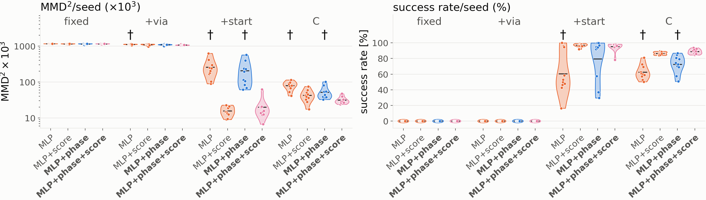

# Point-to-point dual path (skate)

Generated by `scripts/skate/evaluate_fixed_start.py`. The paper uses `fig_p2p_violin`; the rest of this study is supporting material.

## Findings

**What makes the MLP arms work on this task is spread in the *training starts*. Spread elsewhere in the demos (via jitter) doesn't help, and neither does spreading the starts only at evaluation. Once the training starts are spread, the score regularizer is what makes the policies reliable.**

Success by training set (groups) and arm (bars): on each set's own evaluation, then with every policy rolled out from the single nominal start and from the same 1024 draws of C's start distribution (`scripts/skate/plot_p2p_bars.py`).

Four datasets, 4 MLP arms × 10 seeds each, n = 1024 (C is the paper's runs):

| trained on | MLP | MLP+score | MLP+phase | MLP+phase+score |
|---|---:|---:|---:|---:|
| **fixed**: one start, one goal pose, 2 distinct demos | 0% | 0% | 0% | 0% |
| **+via**: one start, via jitter (0.16 m spread mid-path) | 0% | 0% | 0% | 0% |
| **+start**: C's start noise, no via jitter | 60% | **97%** | 79% | **95%** |
| **C** (paper): start noise + via jitter + goal noise | 63% | 87% | 72% | 89% |

Success on each set's own evaluation (its held-out starts: one pose for fixed / +via, C's start distribution for +start / C).

* **Via jitter alone doesn't help.** It even makes the collisions more uniform: 80–100% of seeds drive straight into the block, against 20–80% with no jitter. The likely reason: the jitter spreads the demos from the fork outward while both modes still occupy the same few centimetres around the centre line. So the fork is densely covered by left and right demos at the same states, and every arm learns their average, which is straight ahead. More coverage there is more of the averaging trap, not an escape from it.
* **Start noise alone recovers everything, and more.** With 8 cm / 0.05 rad start noise and no via jitter, the arms match or beat C. The score arms reach 95–97% success against 86–89% on C, from the same start distribution. In the noisy-start data the side is independent of the start (corr 0.03). Start noise works because it spreads the demos where the paths part, so that the side becomes predictable from the position there. The phase-conditioned optimum then sends every start left of centre to the left (Prop. 1; App. B.2).
* **Here the score regularizer does its job.** On +start the score arms cut MMD ×10³ from 206 (MLP+phase) to 16–20 (p ≈ 0.005). They raise success from 79% to 95–97%, with an 18-point gain (p = 0.07) and a much smaller seed spread (± 2–6 vs ± 27). They drive into the block 0% of the time, against 9% for MLP+phase and 17% for the MLP. Phase on its own isn't significant: MLP 60% vs MLP+phase 79%, p = 0.14. On the one-start sets the score target is ~0 away from the fork (`fig_p2p_targets`), and the score arms are as bad as the rest.

**Cross-evaluation (training starts vs evaluation starts):** every policy rolled out from the same single nominal start, and from the same 1024 draws of C's start distribution.

| trained on | single start → goal (seeds of 10): MLP / +score / +phase / +ph.+score | C start distribution → success % |
|---|---|---|
| fixed | 0 / 0 / 0 / 0 | 0 / 0 / 0 / 1 |
| +via | 0 / 0 / 0 / 0 | 1 / 0 / 1 / 0 |
| +start | 3 / **9** / 6 / 6 | 59 / 96 / 79 / 95 |
| C | 0 / **8** / 1 / **8** | 61 / 86 / 72 / 88 |

* **Policies trained from one start fail from a spread of starts too** (0–1%). Spreading the starts only at evaluation does nothing; the damage is in what they learned.
* **Policies trained on spread starts mostly succeed from the one exact start.** That is the hardest start there is, the dead centre line where the two modes are exactly symmetric. The score arms trained on C reach the goal from it in 8 of 10 seeds; MLP+phase in 1 and the MLP in 0. Trained on +start, MLP+score manages 9, MLP+phase 6 and MLP+phase+score 6. The offset sweep (`fig_p2p_cross_offset`) shows the C-trained MLP+phase needs the start ≥ 4 cm off centre before most seeds commit to a side, while the C-trained score arms already succeed in 50–80% of seeds at 0–1 cm. The score term makes the policy break the symmetry decisively instead of averaging the modes.
* So the answer to "is stochasticity essential": yes for these deterministic policies, and specifically **variation in the training starts**. It is what lets a deterministic policy be multimodal (different starts → different modes). Once it is there, the score regularizer turns it into a sharp, symmetric split with few collisions, even from the dead-centre start.

**Mechanism, from the restart test** (policy placed exactly on a held-out demo mid-trajectory): on every point-to-point set, all arms follow the demo 100% of the time from phase ≥ 0.3, so none of this is about tracking a known path. The failures are all at the fork (phase ≈ 0.15), where on the one-start sets the two modes share the same states.

Caveats: 10 seeds per cell. The one-start sets' success is 0/1 per seed, so their means are counts. MMD compares each policy with its own set's held-out demos, so it isn't comparable *across* sets (the +start demos are much narrower than C's, which ends at scattered goals with free headings). Success is comparable: every set uses a 0.6 m goal radius around (5.0, 7.0).

**Follow-up: how much start noise is needed** -- mixtures of 5, 10 and 15% noisy-start demos with the fixed ones (`scripts/skate/start_mix_eval.py`; its report is not included here). 5% already takes every arm from 0 to mostly succeeding; 10% saturates at 96–99% success from C's starts.

**Follow-up: the start spread itself** -- the spread varied with everything else fixed, random against sorted sides, on C's held-out starts and a lateral line sweep (`scripts/skate/start_spread_eval.py`; its report is not included here). 4 cm suffices for every arm (99–100%); more hurts the unregularized arms; random sides beat sorted; the rollouts sort the starts in reverse, because the demos counter-steer.

## Setup

* **data** -- C's world and block, goal pose (5.0, 7.0, π/2) with no noise and the planner's goal constrained in heading (`goal_mode="pose"`); 1024 training demos, a held-out set planned with another seed. The three point-to-point sets differ in one thing each:
  * **fixed** (`dual_path_fixed`) -- start (5.0, 0.9, π/2) with no noise, no via jitter. Each mode is planned once and repeated: one left and one right trajectory ×512, exact mirror images; the held-out set is the same two.
  * **+via** (`dual_path_fixed_via`) -- the same one start, with C's via jitter (0.3 m): the demos spread in the middle of the path (0.16 m at phase 0.5) and share both ends.
  * **+start** (`dual_path_noisy_start`) -- C's start noise (8 cm, 0.05 rad), no via jitter: every demo is the planner's one optimum from its own start (0.11 m spread at the start, narrowing to the goal).
  * **C** -- the paper's scenario: start noise, via jitter, goal position noise (0.2 m) and a free goal heading.
* **arms** -- the paper's MLP arms at n = 1024, 10 seeds, 20k steps, commands clamped to SkateLimits: MLP (no phase), MLP+score (λ=0.5), MLP+phase, MLP+phase+score (λ=0.5). The C rows are the paper's runs of the same arms.
* **success** -- within 0.6 m of the goal (C's 3σ) with no collision; **heading err.** is |θ_final − π/2| (the target in the point-to-point sets; C's goal heading is free).
* In **fixed** and **+via** every held-out start is the same pose, so each seed's 1024 rollouts are one path: success and mode are 0/1 per seed.

## Results (mean ± std over seeds)

| set | arm | seeds | MMD×10³ | success % | obstacle % | wall % | reached L/R % | side L/R/– % | into block % | heading err. ° |
|---|---|---:|---:|---:|---:|---:|---:|---:|---:|---:|
| fixed | MLP (no phase) | 10 | 1160.6 ± 5.6 | 0 ± 0 | 100 ± 0 | 20 ± 42 | 0/0 | 60/40/0 | 20 | 64.8 ± 27.3 |
| fixed | MLP+score (λ=0.5) | 10 | 1146.5 ± 20.8 | 0 ± 0 | 100 ± 0 | 40 ± 52 | 0/0 | 40/60/0 | 50 | 30.9 ± 31.3 |
| fixed | MLP+phase | 10 | 1146.4 ± 30.8 | 0 ± 0 | 100 ± 0 | 40 ± 52 | 0/0 | 80/20/0 | 80 | 15.0 ± 15.1 |
| fixed | MLP+phase+score (λ=0.5) | 10 | 1147.9 ± 19.9 | 0 ± 0 | 100 ± 0 | 50 ± 53 | 0/0 | 30/70/0 | 60 | 30.9 ± 19.2 |
| +via | MLP (no phase) | 10 | 1112.2 ± 28.6 | 0 ± 0 | 100 ± 0 | 0 ± 0 | 0/0 | 70/30/0 | 100 | 58.3 ± 67.4 |
| +via | MLP+score (λ=0.5) | 10 | 1094.3 ± 52.1 | 0 ± 0 | 100 ± 0 | 0 ± 0 | 0/0 | 70/30/0 | 80 | 68.6 ± 78.0 |
| +via | MLP+phase | 10 | 1082.7 ± 38.8 | 0 ± 0 | 100 ± 0 | 0 ± 0 | 0/0 | 40/60/0 | 100 | 5.6 ± 7.9 |
| +via | MLP+phase+score (λ=0.5) | 10 | 1070.6 ± 23.6 | 0 ± 0 | 100 ± 0 | 0 ± 0 | 0/0 | 50/50/0 | 100 | 1.5 ± 2.3 |
| +start | MLP (no phase) | 10 | 257.1 ± 160.5 | 60 ± 27 | 40 ± 27 | 0 ± 0 | 32/29 | 40/60/0 | 17 | 11.0 ± 4.7 |
| +start | MLP+score (λ=0.5) | 10 | 15.8 ± 5.0 | 97 ± 2 | 3 ± 2 | 0 ± 0 | 48/49 | 50/50/0 | 0 | 3.1 ± 0.9 |
| +start | MLP+phase | 10 | 205.6 ± 163.4 | 79 ± 27 | 21 ± 27 | 0 ± 0 | 38/41 | 49/51/0 | 9 | 7.1 ± 4.0 |
| +start | MLP+phase+score (λ=0.5) | 10 | 20.0 ± 15.6 | 95 ± 6 | 5 ± 6 | 0 ± 0 | 48/47 | 52/48/0 | 0 | 1.7 ± 0.6 |
| C | MLP (no phase) | 10 | 80.1 ± 21.8 | 63 ± 9 | 23 ± 12 | 21 ± 13 | 37/39 | 43/56/1 | 20 | 71.1 ± 15.3 |
| C | MLP+score (λ=0.5) | 10 | 42.6 ± 16.3 | 87 ± 2 | 6 ± 2 | 4 ± 2 | 42/52 | 46/54/0 | 3 | 79.3 ± 1.6 |
| C | MLP+phase | 10 | 52.4 ± 22.3 | 72 ± 11 | 12 ± 13 | 8 ± 11 | 46/42 | 49/51/0 | 5 | 70.9 ± 9.1 |
| C | MLP+phase+score (λ=0.5) | 10 | 31.4 ± 7.3 | 89 ± 3 | 5 ± 3 | 2 ± 2 | 48/47 | 50/50/0 | 1 | 76.6 ± 1.5 |

**reached L/R** counts collision-free rollouts on each side. **side** is the side of the block each rollout passes on (`label_mode`: median x while level with the block), collided or not; – is undecided. **into block** is the share whose median x while level with the block lies within the block's x-span: they drove at it, the modes' average, rather than round it.

## Welch t-tests

| comparison | arm | ΔMMD×10³ (p) | Δsuccess % (p) | Δcollision % (p) | Δheading ° (p) |
|---|---|---:|---:|---:|---:|
| fixed: vs MLP+phase | MLP (no phase) | +14.1 (0.18) | +0.0 (n/a) | +0.0 (n/a) | +49.8 (**0.00018**) |
| fixed: vs MLP+phase | MLP+score (λ=0.5) | +0.1 (0.99) | +0.0 (n/a) | +0.0 (n/a) | +15.8 (0.17) |
| fixed: vs MLP+phase | MLP+phase+score (λ=0.5) | +1.5 (0.9) | +0.0 (n/a) | +0.0 (n/a) | +15.9 (0.056) |
| +via: vs MLP+phase | MLP (no phase) | +29.5 (0.07) | +0.0 (n/a) | +0.0 (n/a) | +52.7 (**0.036**) |
| +via: vs MLP+phase | MLP+score (λ=0.5) | +11.6 (0.58) | +0.0 (n/a) | +0.0 (n/a) | +63.0 (**0.031**) |
| +via: vs MLP+phase | MLP+phase+score (λ=0.5) | -12.1 (0.41) | +0.0 (n/a) | +0.0 (n/a) | -4.1 (0.14) |
| +start: vs MLP+phase | MLP (no phase) | +51.6 (0.49) | -19.0 (0.14) | +19.0 (0.14) | +3.9 (0.059) |
| +start: vs MLP+phase | MLP+score (λ=0.5) | -189.8 (**0.0051**) | +17.6 (0.072) | -17.6 (0.071) | -3.9 (**0.012**) |
| +start: vs MLP+phase | MLP+phase+score (λ=0.5) | -185.6 (**0.0058**) | +15.7 (0.11) | -15.7 (0.11) | -5.4 (**0.0019**) |
| fixed vs C | MLP (no phase) | +1080.4 (**2e-18**) | -62.5 (**5.4e-09**) | +76.5 (**6.7e-09**) | -6.3 (0.54) |
| fixed vs C | MLP+score (λ=0.5) | +1103.9 (**4.5e-27**) | -86.5 (**2.9e-16**) | +94.1 (**9.7e-17**) | -48.4 (**0.00085**) |
| fixed vs C | MLP+phase | +1094.0 (**1.3e-23**) | -72.5 (**9.4e-09**) | +87.5 (**6e-09**) | -55.9 (**5.5e-08**) |
| fixed vs C | MLP+phase+score (λ=0.5) | +1116.5 (**1.2e-20**) | -88.7 (**1.2e-14**) | +94.6 (**1.1e-15**) | -45.7 (**3.5e-05**) |
| +via vs C | MLP (no phase) | +1032.1 (**4.7e-24**) | -62.5 (**5.4e-09**) | +76.5 (**6.7e-09**) | -12.8 (0.57) |
| +via vs C | MLP+score (λ=0.5) | +1051.7 (**5.3e-15**) | -86.5 (**2.9e-16**) | +94.1 (**9.7e-17**) | -10.7 (0.68) |
| +via vs C | MLP+phase | +1030.3 (**7.9e-20**) | -72.5 (**9.4e-09**) | +87.5 (**6e-09**) | -65.3 (**1.9e-12**) |
| +via vs C | MLP+phase+score (λ=0.5) | +1039.1 (**1.4e-18**) | -88.7 (**1.2e-14**) | +94.6 (**1.1e-15**) | -75.1 (**2.3e-22**) |
| +start vs C | MLP (no phase) | +177.0 (**0.0068**) | -2.1 (0.82) | +16.1 (0.11) | -60.1 (**1.7e-07**) |
| +start vs C | MLP+score (λ=0.5) | -26.8 (**0.00046**) | +10.4 (**1.9e-09**) | -2.9 (**0.0059**) | -76.2 (**1.7e-22**) |
| +start vs C | MLP+phase | +153.1 (**0.016**) | +6.9 (0.47) | +8.1 (0.41) | -63.8 (**7.4e-11**) |
| +start vs C | MLP+phase+score (λ=0.5) | -11.5 (0.056) | +6.3 (**0.011**) | -0.5 (0.82) | -74.9 (**4.6e-21**) |

p is n/a where both samples are constant (e.g. every seed collides).

## Restarted on a demo

Each trained policy put back *onto* held-out demos at a given phase (the demo's exact pose, the phase input set to match) and rolled out to the end: 10 demos per mode (the two, for **fixed**) × 10 seeds. **tracks** = share of restarts that stay within 0.3 m of their demo with no collision. The demos fork at phase ≈ 0.15.

| set | arm | from 0.1 | from 0.2 | from 0.3 | from 0.5 |
|---|---|---:|---:|---:|---:|
| fixed | MLP (no phase) | 20% | 35% | 95% | 100% |
| fixed | MLP+score (λ=0.5) | 100% | 100% | 100% | 100% |
| fixed | MLP+phase | 70% | 100% | 100% | 100% |
| fixed | MLP+phase+score (λ=0.5) | 100% | 100% | 100% | 100% |
| +via | MLP (no phase) | 19% | 100% | 100% | 100% |
| +via | MLP+score (λ=0.5) | 0% | 22% | 100% | 100% |
| +via | MLP+phase | 100% | 100% | 100% | 100% |
| +via | MLP+phase+score (λ=0.5) | 14% | 62% | 100% | 100% |
| +start | MLP (no phase) | 30% | 100% | 100% | 100% |
| +start | MLP+score (λ=0.5) | 44% | 100% | 100% | 100% |
| +start | MLP+phase | 30% | 100% | 100% | 100% |
| +start | MLP+phase+score (λ=0.5) | 44% | 100% | 100% | 100% |
| C | MLP (no phase) | 10% | 62% | 68% | 69% |
| C | MLP+score (λ=0.5) | 6% | 43% | 48% | 62% |
| C | MLP+phase | 12% | 42% | 48% | 62% |
| C | MLP+phase+score (λ=0.5) | 21% | 42% | 45% | 62% |

C's restart rates are not comparable with the others: its demos end at scattered goals (σ = 0.2 m) with free headings, and a policy heads for their mean, so it leaves a single demo near the end whatever it does at the fork.

## Cross-evaluation: every policy from the same starts

Each set's own evaluation starts from its held-out starts, so training-start and evaluation-start spread move together. Here every trained policy is rolled out (`scripts/skate/cross_start_eval.py`) from **the single nominal start** (5.0, 0.9, π/2) -- one deterministic path per seed -- and from **1024 starts drawn from C's start distribution** (8 cm, 0.05 rad; one draw shared by every policy). Success is reaching within 0.6 m of (5.0, 7.0) with no collision. **own eval.** is the set's own evaluation, for reference.

| trained on | arm | seeds | single start: seeds reaching goal | into block | start dist.: success % | reached left/right % | own eval. success % |
|---|---|---:|---:|---:|---:|---:|---:|
| fixed | MLP | 10 | 0/10 | 2/10 | 0 ± 0 | 0/0 | 0 |
| fixed | MLP+score | 10 | 0/10 | 5/10 | 0 ± 0 | 0/0 | 0 |
| fixed | MLP+phase | 10 | 0/10 | 8/10 | 0 ± 0 | 0/0 | 0 |
| fixed | MLP+ph.+score | 10 | 0/10 | 6/10 | 1 ± 0 | 0/0 | 0 |
| +via | MLP | 10 | 0/10 | 10/10 | 1 ± 1 | 0/0 | 0 |
| +via | MLP+score | 10 | 0/10 | 8/10 | 0 ± 0 | 0/0 | 0 |
| +via | MLP+phase | 10 | 0/10 | 10/10 | 1 ± 0 | 0/0 | 0 |
| +via | MLP+ph.+score | 10 | 0/10 | 10/10 | 0 ± 0 | 0/0 | 0 |
| +start | MLP | 10 | 3/10 | 4/10 | 59 ± 27 | 33/27 | 60 |
| +start | MLP+score | 10 | 9/10 | 0/10 | 96 ± 3 | 49/47 | 97 |
| +start | MLP+phase | 10 | 6/10 | 1/10 | 79 ± 28 | 39/40 | 79 |
| +start | MLP+ph.+score | 10 | 6/10 | 1/10 | 95 ± 6 | 49/46 | 95 |
| C | MLP | 10 | 0/10 | 7/10 | 61 ± 9 | 30/31 | 63 |
| C | MLP+score | 10 | 8/10 | 1/10 | 86 ± 3 | 37/49 | 87 |
| C | MLP+phase | 10 | 1/10 | 4/10 | 72 ± 12 | 37/34 | 72 |
| C | MLP+ph.+score | 10 | 8/10 | 0/10 | 88 ± 3 | 44/43 | 89 |

From the nominal start shifted in x (heading unchanged), the share of the 10 seeds that reach the goal; 0 is the exact centre line, where the two modes are symmetric:

## Figures

Rollouts: every seed's path where the start is fixed, seed 0's rollouts where it is not:

x over phase for the one-start sets, a line per seed, against the demos (grey):

